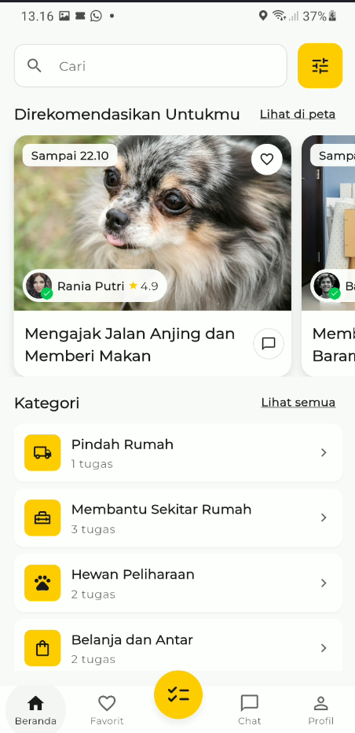
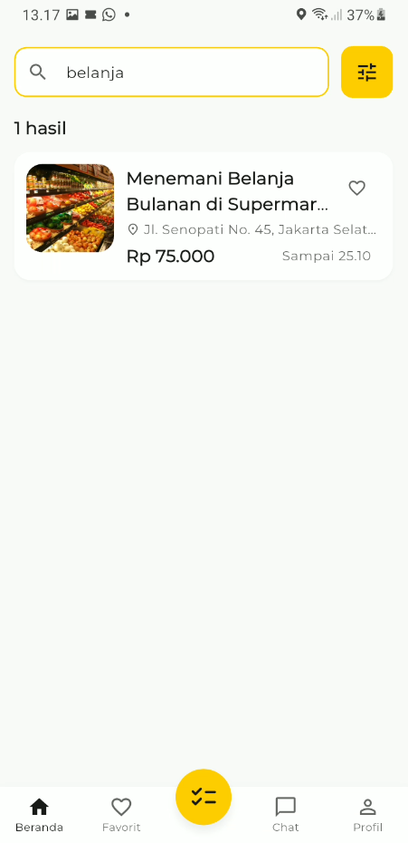
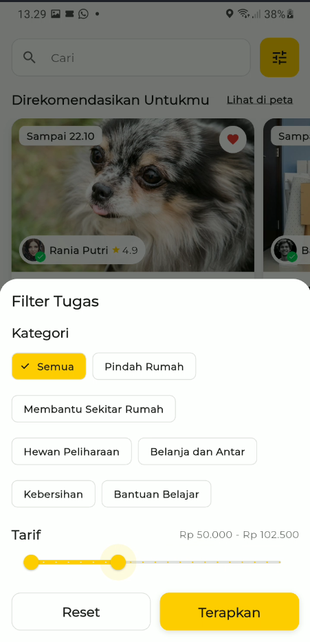
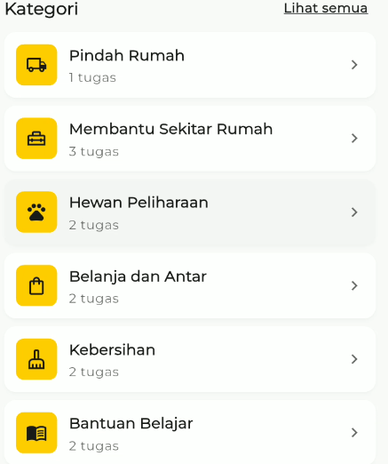
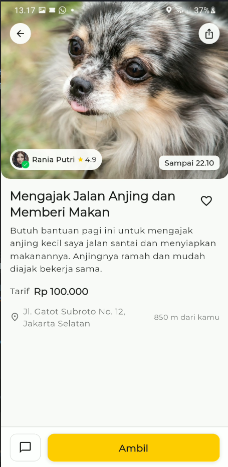
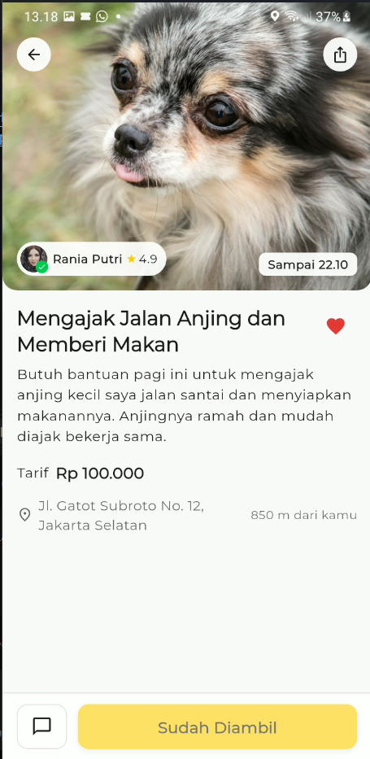
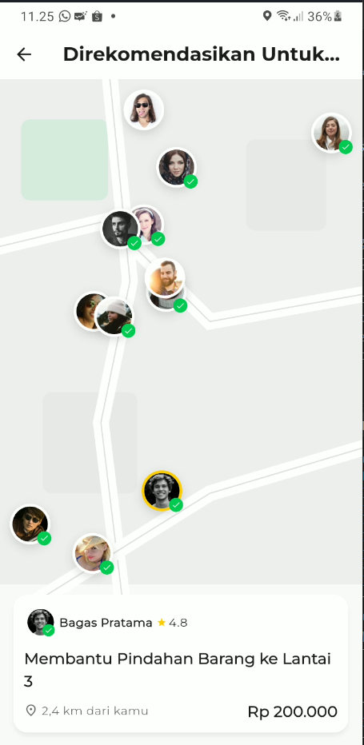
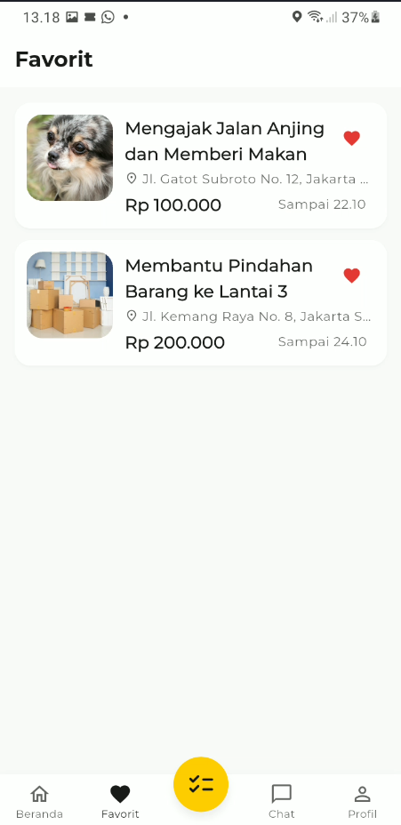
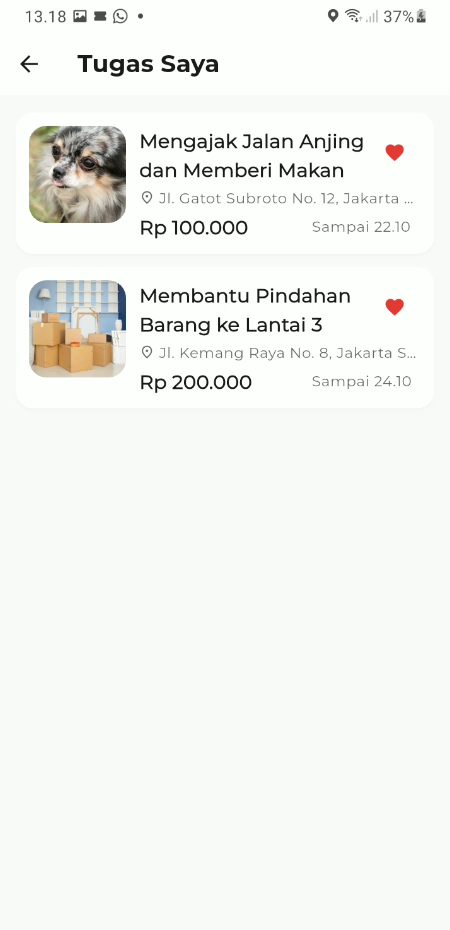
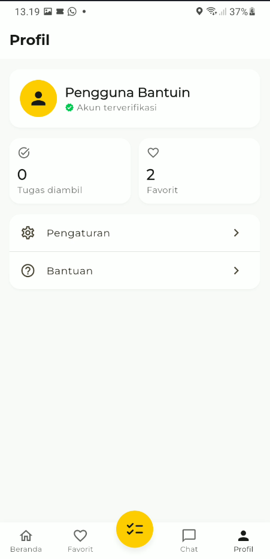

# Bantuin

**Bantuin** adalah aplikasi *marketplace* tugas harian berbasis bantuan sesama. Pengguna berperan sebagai **agen**: mencari tugas di sekitarnya, membaca detail, menyimpan favorit, lalu menekan **Ambil** untuk mengerjakan tugas dan menerima imbalan dalam Rupiah. Aplikasi **tidak menyediakan fitur membuat atau memasang tugas**; daftar tugas berasal dari data dummy yang disediakan aplikasi.

Aplikasi dibuat untuk memenuhi tugas UTS Mobile Programming menggunakan Flutter. Seluruh teks antarmuka menggunakan Bahasa Indonesia, nominal mata uang Rupiah, tampilan responsif, dan tidak mengandung unsur SARA.

## Tema dan Tujuan

- **Tema:** gotong royong dan tolong-menolong dalam aktivitas harian.
- **Tujuan:** mempertemukan pemosting tugas dengan agen yang bersedia membantu, dengan informasi tugas, lokasi, tenggat, dan imbalan yang jelas.
- **Peran pengguna:** hanya sebagai agen yang mencari dan mengambil tugas. Tidak ada alur membuat, mengubah, atau memasang tugas.
- **Gaya visual:** bersih dan ramah, dengan aksen kuning `#FFCC00`, kartu putih, sudut membulat, serta font **Montserrat** melalui paket `google_fonts`.
- **Cakupan versi ini:** prototipe dengan data JSON lokal. Favorit dan tugas yang diambil disimpan di memori melalui `AppState`; data tersebut kembali kosong ketika aplikasi ditutup.

## Fitur Utama

- Pencarian tugas dari **seluruh data**, bukan hanya empat kartu rekomendasi. Kata kunci dicocokkan secara *case-insensitive* pada judul, deskripsi, dan lokasi.
- Filter kategori dan rentang tarif. Hasil filter digabungkan dengan kata kunci pencarian.
- Daftar hasil pencarian atau filter berupa kartu vertikal `TaskListCard`, lengkap dengan jumlah hasil dan empty state `Tugas tidak ditemukan`.
- Kartu rekomendasi horizontal dan daftar kategori pada tampilan normal Beranda.
- Halaman kategori dengan status loading, error, empty state, favorit, dan navigasi ke detail.
- Halaman detail tugas dengan foto, pemosting terverifikasi, rating, tenggat, tarif, lokasi, jarak, favorit, dan tombol **Ambil**.
- Halaman **Tugas Saya** yang dibuka melalui tombol ceklis kuning di tengah bottom navigation.
- Halaman favorit yang reaktif terhadap perubahan `AppState`.
- Peta statis yang memosisikan avatar pemosting berdasarkan koordinat, tanpa Google Maps API.
- Chat dummy, profil pengguna, dan navigasi bawah lima item.

## Daftar Halaman

| File | Halaman | Fungsi |
| --- | --- | --- |
| `lib/pages/main_shell.dart` | Kerangka utama | Menyediakan `BottomNavigationBar` lima item dan `IndexedStack` untuk Beranda, Favorit, Chat, serta Profil. Tombol ceklis kuning di tengah membuka **Tugas Saya** melalui `Navigator.push`. |
| `lib/pages/home_page.dart` | Beranda | Menampilkan search bar, tombol filter, empat kartu rekomendasi, dan daftar kategori beserta jumlah tugas. Pencarian memeriksa judul, deskripsi, dan lokasi dari seluruh tugas. Filter membuka bottom sheet kategori dan `RangeSlider` tarif. Saat pencarian/filter aktif, bagian rekomendasi dan kategori disembunyikan dan diganti daftar hasil vertikal. |
| `lib/pages/category_page.dart` | Kategori | Menampilkan tugas berdasarkan kategori terpilih menggunakan `TaskListCard`, dengan loading, error, empty state, tombol favorit, dan navigasi ke detail. |
| `lib/pages/detail_page.dart` | Detail Tugas | Menampilkan foto header, chip pemosting, tenggat, judul, deskripsi, tarif, lokasi, jarak, tombol favorit, tombol bagikan, tombol chat, dan tombol **Ambil**. Tombol **Ambil** meminta konfirmasi lalu menyimpan ID tugas ke `AppState`. Bila tugas sudah diambil atau selesai, tombol dinonaktifkan. |
| `lib/pages/map_page.dart` | Peta | Menampilkan peta statis dengan avatar pemosting yang diposisikan dari `lat`/`lng`, mekanisme penyebaran avatar yang berdekatan, kartu info tugas terpilih, dan navigasi ke detail. |
| `lib/pages/favorites_page.dart` | Favorit | Menampilkan tugas yang disimpan melalui `AppState`, memperbarui daftar saat favorit diubah, dan menyediakan empty state. |
| `lib/pages/chat_page.dart` | Chat | Menampilkan daftar percakapan dummy dengan nama, pesan terakhir, dan waktu. Aksi membuka percakapan masih berupa placeholder. |
| `lib/pages/profile_page.dart` | Profil | Menampilkan kartu pengguna, jumlah favorit, statistik tugas diambil, serta menu Pengaturan dan Bantuan. Menu **Tugas Saya** tidak lagi berada di sini karena dipindahkan ke tombol tengah bottom navigation. |
| `lib/pages/my_tasks_page.dart` | Tugas Saya | Menampilkan tugas berstatus `diambil` atau ID yang tercatat di `AppState`, berupa `TaskListCard`; item dapat dibuka ke detail. Menyediakan tombol kembali dan empty state `Belum ada tugas yang diambil`. Karena seluruh data dummy saat ini berstatus `tersedia`, halaman ini kosong sampai pengguna mengambil tugas. |

## Alur Navigasi

- `MainShell` menampilkan empat halaman utama melalui `IndexedStack`: Beranda, Favorit, Chat, dan Profil.
- Tombol ceklis kuning di tengah bottom navigation **bukan tab biasa**; tombol ini membuka `MyTasksPage` dengan `Navigator.push`.
- Dari Beranda pengguna dapat membuka Peta, Kategori, dan Detail Tugas.
- Dari Kategori, Peta, Favorit, dan Tugas Saya pengguna dapat membuka Detail Tugas.
- Rute terpusat berada di `lib/routes/app_routes.dart`:

| Rute | Halaman |
| --- | --- |
| `/kategori` | Kategori, menerima argumen `Category` |
| `/detail` | Detail Tugas, menerima argumen `Task` |
| `/peta` | Peta |
| `/favorit` | Favorit |
| `/chat` | Chat |
| `/profil` | Profil |
| `/tugas-saya` | Tugas Saya |

## Struktur Folder

```text
uts/
├── lib/
│   ├── main.dart                     # Entry point, tema, AppStateScope, dan rute
│   ├── models/
│   │   ├── category.dart             # Model kategori + konversi JSON
│   │   └── task.dart                 # Model tugas, status, + konversi JSON
│   ├── pages/
│   │   ├── main_shell.dart           # Bottom navigation dan IndexedStack
│   │   ├── home_page.dart            # Beranda, pencarian, dan filter
│   │   ├── category_page.dart        # Daftar tugas per kategori
│   │   ├── detail_page.dart          # Detail dan aksi ambil tugas
│   │   ├── map_page.dart             # Peta statis dan kartu info tugas
│   │   ├── favorites_page.dart       # Tugas favorit
│   │   ├── chat_page.dart            # Daftar percakapan dummy
│   │   ├── profile_page.dart         # Profil pengguna
│   │   └── my_tasks_page.dart        # Tugas yang sudah diambil
│   ├── services/
│   │   ├── task_repository.dart      # TaskRepository + LocalJsonRepository
│   │   └── app_state.dart            # State favorit dan tugas yang diambil
│   ├── widgets/
│   │   ├── app_image.dart            # Gambar aset/jaringan + placeholder
│   │   ├── app_search_bar.dart       # Kolom pencarian
│   │   ├── category_tile.dart        # Tile kategori + pemetaan ikon
│   │   ├── filter_button.dart        # Tombol filter kuning
│   │   ├── primary_button.dart       # Tombol utama kuning
│   │   ├── task_card.dart            # Kartu tugas horizontal
│   │   ├── task_list_card.dart       # Kartu tugas vertikal
│   │   └── verified_avatar_chip.dart # Avatar + centang verifikasi
│   ├── theme/
│   │   └── app_theme.dart            # Warna, radius, spacing, shadow, tipografi
│   └── routes/
│       └── app_routes.dart           # Nama dan definisi rute navigasi
├── assets/
│   ├── data/
│   │   ├── categories.json           # Enam kategori dummy
│   │   └── tasks.json                # Dua belas tugas dummy
│   └── images/
│       └── tasks/                    # task_1.jpg - task_4.jpg
├── design/
│   └── ui_reference.png              # Referensi visual utama
├── docs/
│   ├── DESIGN.md                     # Spesifikasi desain
│   ├── Soal UTS.pdf                  # Dokumen soal
│   └── screenshots/
│       └── placeholder.svg           # Placeholder screenshot
├── test/
│   └── widget_test.dart              # Widget test dasar
└── pubspec.yaml                      # Dependensi dan aset Flutter
```

## Tema Visual

- **Font:** Montserrat dari `google_fonts`, diterapkan melalui `AppTheme.light`.
- **Aksen utama:** `#FFCC00`.
- **Pendekatan:** Material 3, kartu putih, latar abu sangat terang, dan sudut membulat.
- **Token desain:** warna, radius, spacing, dan shadow dipusatkan di `lib/theme/app_theme.dart` melalui `AppColors`, `AppRadius`, `AppSpacing`, `AppShadows`, dan `AppTheme`.

| Token | Nilai | Penggunaan |
| --- | --- | --- |
| Aksen | `#FFCC00` | Tombol utama, filter, dan tombol tengah |
| Background | `#FAFAFA` | Latar halaman |
| Surface | `#FFFFFF` | Kartu, search bar, dan navigasi |
| Teks utama | `#1A1A1A` | Judul dan nominal Rupiah |
| Teks sekunder | `#666666` | Keterangan dan caption |
| Verifikasi | `#00C853` | Centang akun terverifikasi |
| Divider | `#E0E0E0` | Garis pemisah |
| Favorit | `#E53935` | Ikon hati aktif |

## Data JSON

Data dummy berada di `assets/data/` dan didaftarkan pada bagian `assets` di `pubspec.yaml`. `LocalJsonRepository` membacanya menggunakan `rootBundle`, mengubah JSON menjadi model, lalu menyimpan cache di memori selama repository digunakan.

### `categories.json`

Berisi array kategori dengan struktur berikut:

```json
{
  "id": "pindah-rumah",
  "nama": "Pindah Rumah",
  "ikon": "local_shipping"
}
```

| Field | Tipe | Keterangan |
| --- | --- | --- |
| `id` | string | ID unik kategori dan penghubung ke `categoryId` pada tugas. |
| `nama` | string | Nama kategori yang ditampilkan. |
| `ikon` | string | Nama ikon Material yang dipetakan oleh `categoryIconFromName` di `category_tile.dart`. |

Saat ini tersedia enam kategori: Pindah Rumah, Membantu Sekitar Rumah, Hewan Peliharaan, Belanja dan Antar, Kebersihan, dan Bantuan Belajar.

### `tasks.json`

Berisi array tugas dengan struktur berikut:

```json
{
  "id": "tugas-001",
  "judul": "Mengajak Jalan Anjing dan Memberi Makan",
  "deskripsi": "Butuh bantuan pagi ini ...",
  "categoryId": "hewan-peliharaan",
  "tarif": 100000,
  "lokasi": "Jl. Gatot Subroto No. 12, Jakarta Selatan",
  "jarak_meter": 850,
  "lat": -6.2297,
  "lng": 106.8169,
  "batas_waktu": "2026-10-22T08:00:00+07:00",
  "nama_pemosting": "Rania Putri",
  "rating": 4.9,
  "verified": true,
  "foto_url": "assets/images/tasks/task_1.jpg",
  "foto_pemosting_url": "https://i.pravatar.cc/150?img=47",
  "status": "tersedia"
}
```

| Field | Tipe | Keterangan |
| --- | --- | --- |
| `id` | string | ID unik tugas. |
| `judul` | string | Judul singkat tugas. |
| `deskripsi` | string | Penjelasan kebutuhan tugas. |
| `categoryId` | string | ID kategori pada `categories.json`. |
| `tarif` | integer | Imbalan dalam Rupiah dan ditampilkan dengan format `Rp 100.000`. |
| `lokasi` | string | Alamat lokasi tugas; ikut diperiksa saat pencarian. |
| `jarak_meter` | integer | Jarak lokasi dari pengguna dalam meter. |
| `lat`, `lng` | double | Koordinat untuk memosisikan avatar pada peta statis. |
| `batas_waktu` | string | Tanggal dan waktu dalam format ISO-8601. |
| `nama_pemosting` | string | Nama pemosting tugas. |
| `rating` | double | Rating pemosting. |
| `verified` | boolean | Status verifikasi pemosting. |
| `foto_url` | string | Path aset lokal atau URL foto tugas. |
| `foto_pemosting_url` | string | URL foto profil pemosting. |
| `status` | string | `tersedia`, `diambil`, atau `selesai`. |

Data saat ini berisi **12 tugas** dan seluruhnya berstatus `tersedia`. Empat tugas pertama memakai aset lokal `task_1.jpg` sampai `task_4.jpg`; tugas lainnya memakai URL `loremflickr.com`. Foto pemosting memakai URL `i.pravatar.cc`. `AppImage` dan `VerifiedAvatarChip` menampilkan placeholder atau inisial bila gambar gagal dimuat.

Halaman **Tugas Saya** membaca tugas berstatus `diambil` dari JSON, ditambah ID tugas yang dicatat `AppState` setelah pengguna menekan **Ambil**. Dengan data awal yang seluruhnya `tersedia`, daftar Tugas Saya kosong pada saat aplikasi pertama dibuka.

## Peran `TaskRepository` dan Rencana Integrasi API

`TaskRepository` di `lib/services/task_repository.dart` adalah kontrak sumber data. Halaman UI bergantung pada abstraksi ini, bukan pada cara data dimuat. Implementasi saat ini adalah `LocalJsonRepository`; implementasi API dapat ditambahkan tanpa mengubah widget atau alur navigasi.

### Kontrak `TaskRepository`

| Method | Fungsi | Rencana endpoint API |
| --- | --- | --- |
| `getCategories()` | Mengambil seluruh kategori. | `GET /categories` |
| `getTasks()` | Mengambil seluruh tugas. | `GET /tasks` |
| `getTasksByCategory(categoryId)` | Mengambil tugas pada satu kategori. | `GET /tasks?categoryId={id}` |
| `getTaskById(id)` | Mengambil satu tugas berdasarkan ID. | `GET /tasks/{id}` |
| `countTasksByCategory()` | Menghitung jumlah tugas per kategori. | `GET /categories/counts` atau dihitung dari `GET /tasks` |

`LocalJsonRepository` membaca aset `categories.json` dan `tasks.json` melalui `rootBundle`, mengubahnya dengan `Category.fromJson` dan `Task.fromJson`, serta menyimpan cache di memori. Method `getTasksByCategory`, `getTaskById`, dan `countTasksByCategory` dibangun di atas data tugas yang sudah dimuat.

Halaman `HomePage`, `CategoryPage`, `MapPage`, `FavoritesPage`, dan `MyTasksPage` menerima parameter `repository` opsional. `MainShell` membuat satu repository dan meneruskannya ke Beranda, Favorit, serta Tugas Saya. Pola ini memudahkan penggantian sumber data dan pengujian.

### Rencana integrasi API

1. Tambahkan paket HTTP seperti `http` atau `dio` pada `pubspec.yaml`.
2. Buat `ApiTaskRepository implements TaskRepository` di `lib/services/` dengan `baseUrl` dari konfigurasi, misalnya `--dart-define=API_BASE_URL=...`.
3. Petakan respons JSON API ke `Category.fromJson` dan `Task.fromJson`; gunakan adapter bila nama field backend berbeda.
4. Ubah kegagalan HTTP menjadi exception yang jelas agar loading, error, dan tombol **Coba lagi** pada halaman yang sudah ada tetap bekerja.
5. Suntikkan `ApiTaskRepository` melalui parameter `repository` atau jadikan implementasi API sebagai nilai default di composition root.
6. Tambahkan endpoint untuk aksi yang saat ini disimpan lokal: favorit (`POST /favorites`, `DELETE /favorites/{id}`) dan pengambilan tugas (`PATCH /tasks/{id}/status` atau endpoint khusus ambil tugas).
7. Tambahkan autentikasi, pagination, dan penanganan token saat backend tersedia.

Tidak direncanakan endpoint untuk membuat tugas karena aplikasi hanya digunakan oleh agen untuk mencari dan mengambil tugas.

## Fitur yang Masih Berupa Tampilan Saja

Fitur berikut sudah tampil di antarmuka, tetapi belum terhubung ke layanan nyata:

- **Bagikan** pada Detail Tugas menampilkan snackbar.
- **Chat pemosting** pada kartu tugas dan Detail Tugas menampilkan snackbar.
- Daftar **Chat** berisi percakapan dummy; menekan percakapan menampilkan snackbar.
- **Lihat semua** pada bagian kategori di Beranda menampilkan snackbar.
- Menu **Pengaturan** dan **Bantuan** di Profil menampilkan snackbar.
- **Peta** adalah peta statis. Posisi avatar dihitung dari koordinat dummy, bukan dari GPS atau Google Maps. Aset `assets/images/map.png` belum tersedia, sehingga tampil fallback gambar jalan dari `CustomPaint`.
- Statistik **Tugas diambil** di Profil mengikuti data tugas dan `AppState`, sama dengan halaman Tugas Saya; jumlah favorit juga mengikuti `AppState`.
- Favorit dan tugas yang diambil hanya tersimpan di memori dan kembali kosong saat aplikasi ditutup.
- Belum ada autentikasi, backend, pembayaran, notifikasi, atau penyimpanan permanen.

Semua tombol placeholder memakai snackbar dengan pesan yang sama: `Fitur ini akan tersedia pada pengembangan berikutnya`.

## Screenshot

Seluruh gambar di `docs/screenshots/` ditampilkan pada galeri berikut, diurutkan berdasarkan nama file.

| No. | Galeri | Nama File | Keterangan |
| ---: | --- | --- | --- |
| 1 |  | `01_beranda.png` | Halaman Beranda dengan pencarian, rekomendasi, dan kategori. |
| 2 |  | `02_pencarian.png` | Hasil pencarian tugas pada Beranda. |
| 3 |  | `03_filter.png` | Bottom sheet filter kategori dan rentang tarif. |
| 4 |  | `04_kategori.png` | Halaman daftar tugas berdasarkan kategori. |
| 5 |  | `05_detail.png` | Halaman detail tugas dengan tombol Ambil. |
| 6 |  | `06_detail_diambil.png` | Detail tugas setelah statusnya diambil. |
| 7 |  | `07_peta.png` | Peta statis dengan sebaran avatar pemosting. |
| 8 |  | `08_favorit.png` | Halaman tugas yang disimpan sebagai favorit. |
| 9 |  | `09_tugas_saya.png` | Halaman Tugas Saya yang dibuka dari tombol tengah. |
| 10 |  | `10_profil.png` | Halaman profil pengguna. |


## Menjalankan Aplikasi

Prasyarat: Flutter SDK sudah terpasang dan sesuai constraint Dart pada `pubspec.yaml`.

```bash
# Mengambil dependensi
flutter pub get

# Menjalankan aplikasi pada perangkat/emulator yang aktif
flutter run
```

Perintah pendukung:

```bash
flutter analyze   # Memeriksa error, warning, dan lint
flutter test      # Menjalankan widget test dasar
```

## Referensi Desain

- Referensi desain: Aleksandr Volodkovich, "Find Assistants - Mobile App" (Dribbble, https://dribbble.com/shots/19553505-Find-Assistants-Mobile-App) dan berkas "Task App" (Figma Community, https://www.figma.com/community/file/1158702322980754042/task-app); dimodifikasi: teks Bahasa Indonesia, aksen kuning, dan mata uang Rupiah.
- Referensi visual lokal: `design/ui_reference.png`.
- Spesifikasi warna, tipografi, radius, shadow, spacing, dan komponen: `docs/DESIGN.md`.
- Soal UTS: `docs/Soal UTS.pdf`.

Modifikasi yang dilakukan meliputi identitas aplikasi Bantuin, aksen `#FFCC00`, teks Bahasa Indonesia, nominal Rupiah, alur khusus agen tanpa pembuatan tugas, pencarian dan filter seluruh tugas, halaman Tugas Saya melalui tombol tengah, favorit, chat dummy, profil, serta peta statis tanpa Google Maps API.
